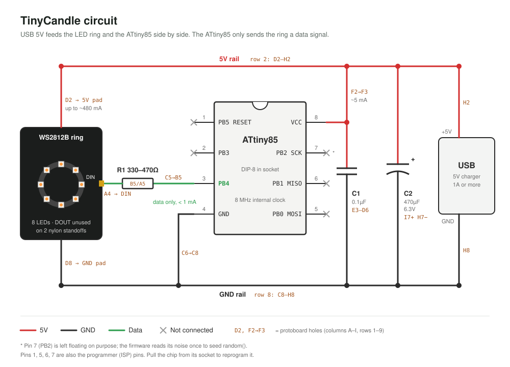

# TinyCandle

A flickering candle light: an ATtiny85 on a 9×9 mini protoboard drives an 8-LED WS2812B ring, powered by a 5V USB charger. The light mounts on a jar lid, and the glass jar goes upside down over it as a diffuser.



## What's here

| Path | Contents |
|---|---|
| [`attiny85-candle-light.md`](attiny85-candle-light.md) | Build plan: parts list, protoboard layout, programming steps, firmware, troubleshooting |
| [`cad/candle_light.py`](cad/candle_light.py) | build123d source for the full assembly (board, socket, chip, ring, standoffs, wiring, jar) |
| [`cad/candle_board.py`](cad/candle_board.py) | Earlier board-only model |
| `out/candle_light.step` | Full assembly, one labelled body per part |
| `out/candle_board.step`, `out/candle_board.stl` | Board-only model |
| `out/parts/*.stl` | One STL per part, used by the viewer |
| `out/candle_circuit.svg` | Circuit diagram with protoboard hole positions |
| `out/candle_board_viewer.html` | Self-contained interactive 3D viewer (three.js) |
| `out/renders/` | Preview renders |
| `tools/build_viewer.py` | Rebuilds the viewer from `out/parts/*.stl` and `tools/viewer_template.html` |

## Circuit summary

- USB 5V and GND feed two protoboard rails (row 2 and row 8).
- The LED ring takes power straight from the rails (D2, D8). The ATtiny85 never carries the ring's current.
- ATtiny85 pin 3 (PB4) sends data through a 330–470Ω resistor to the ring's DIN.
- A 0.1µF cap decouples the chip; a 470µF bulk cap on the board covers LED current spikes.
- The chip sits in a machined-pin DIP-8 socket so it can be pulled for reprogramming.

## Mechanical summary

- The ring is centred over the chip on two M2 × 15 mm male-female nylon standoffs at protoboard holes G1 and B8 (drilled to 2.2 mm), with nuts underneath.
- The protoboard stands 6 mm off the jar lid on one M2.5 screw through its mounting hole.

Dimensions marked as placeholders in the viewer (jar, lid, ring pad order, ring hole spacing) still need to be measured from the real parts.

## Regenerating outputs

The model was built with [build123d](https://github.com/gumyr/build123d) through the build123d-mcp server. `cad/candle_light.py` is the modeling session replayed in order. It uses the server's session helpers (`show`, `clearance`, `measure`), so run it through build123d-mcp's `execute_file`, or stub those helpers to run it in plain build123d. Later blocks supersede earlier ones (for example, the ring is rebuilt after it was re-positioned).

To rebuild the viewer after changing any part STL:

```sh
python3 tools/build_viewer.py
```

## Units

All dimensions are in millimetres. Protoboard holes are named by column (A–I) and row (1–9) on a 2.54 mm grid, viewed from the component side with the socket notch toward row 1.
